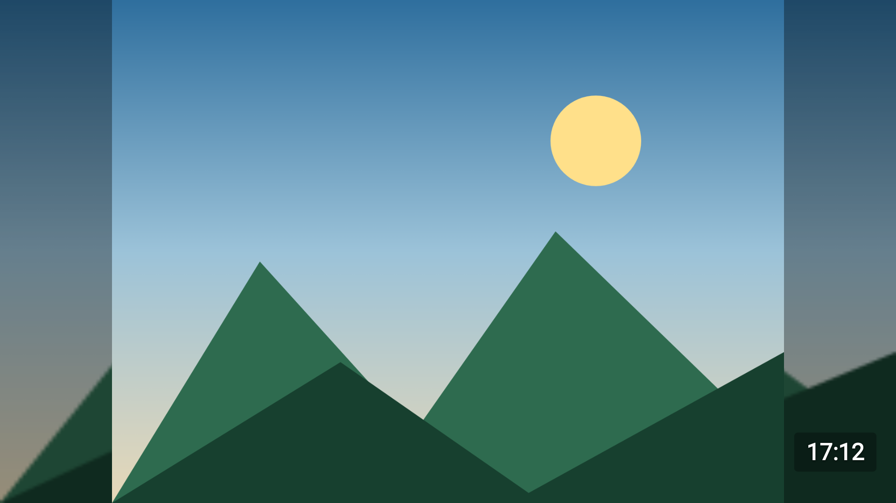
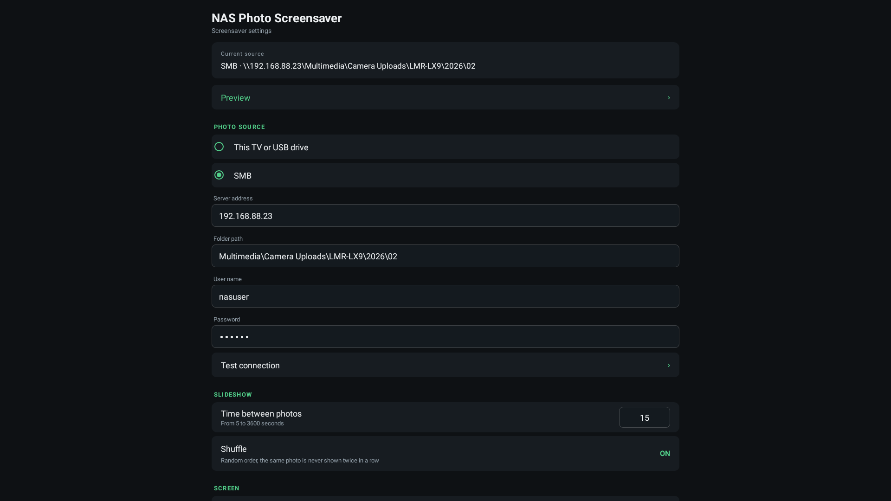
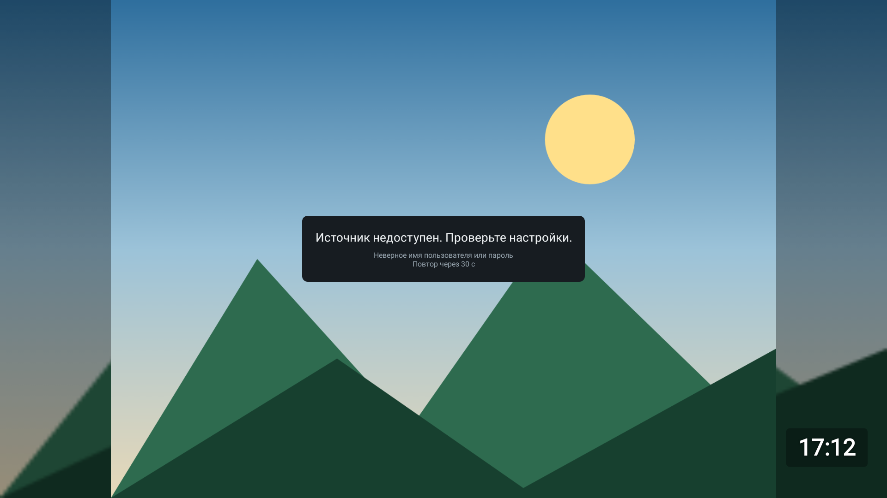

# NAS Фотоскринсейвер для Xiaomi TV (Android TV)

Скринсейвер-слайдшоу, который показывает фотографии с NAS (SMB) или из папки на
телевизоре/USB-накопителе. Рассчитан на 4K-телевизоры Xiaomi TV A2 55"/43"
(L55M7-EARU, L43M7-EARU), минимальная версия — Android TV 9 (API 28).

**Готовый APK:** [`dist/nas2screen-1.0.0-release.apk`](dist/nas2screen-1.0.0-release.apk)
(7,4 МБ, подписан, `minSdk 28`, `targetSdk 34`)



## Что умеет

- Запускается как **системная экранная заставка** (`DreamService`) — ТВ сам
  включает её после простоя, выбранного в настройках ТВ.
- Два источника, переключаются в настройках:
  - **Этот телевизор или USB-накопитель** — выбор папки системным диалогом (SAF)
    либо встроенным браузером папок (если на прошивке нет системного выбора).
  - **SMB** — папка на NAS/ПК/сервере (SMB 2.0/2.1/3.x, **SMB1 не используется**).
- Рекурсивный обход подпапок, форматы **JPG/JPEG, PNG, WEBP, HEIC/HEIF**.
  RAW и GIF не поддерживаются. EXIF-ориентация учитывается.
- Кнопка **«Проверить подключение»**: при успехе зелёная плашка с количеством
  найденных фото, при ошибке — красная с причиной.
- **Интервал** 5–3600 с (по умолчанию 10 с), **перемешивание**, зацикливание,
  плавный переход (crossfade 500 мс).
- **Часы** справа снизу, 24-часовой формат, с медленным дрейфом ±20 px
  (защита от выгорания матрицы).
- Фото вписывается без искажений и обрезки, свободные полосы заполняются
  размытой копией того же снимка (копия ≤ 1/10 экрана).
- Ошибки источника показываются текстом на экране, повтор каждые 30 с.
- Русский и английский интерфейс (по системной локали, иначе английский).

## Скриншоты

| Настройки (SMB) | Ошибка источника |
|---|---|
|  |  |

Эти картинки — не макеты, а реальный рендер экранов приложения
(тест `ScreenshotTest` рисует живые view в 1920×1080).

## Установка

1. Включите на ТВ отладку по ADB: *Настройки → Система → О телевизоре →
   нажать 7 раз на «Сборка»*, затем *Настройки → Система → Для разработчиков →
   Отладка по ADB*.
2. Установите APK с компьютера:

   ```powershell
   adb connect 192.168.88.XX:5555
   adb install -r dist\nas2screen-1.0.0-release.apk
   ```

   (`adb.exe` есть в `.android-sdk\platform-tools\`.)

3. Включите заставку: *Настройки → Устройство → Экранная заставка* →
   выберите **«Фотоскринсейвер NAS»** и задайте время до включения.
4. Откройте приложение из лаунчера, настройте источник, нажмите
   «Проверить подключение», затем «Предпросмотр».

## Настройка источника

### SMB (папка на NAS)

| Поле | Пример для `\\192.168.88.23\Multimedia/Camera Uploads/LMR-LX9/2026/02` |
|---|---|
| Адрес сервера | `192.168.88.23` |
| Путь к папке | `Multimedia/Camera Uploads/LMR-LX9/2026/02` |
| Имя пользователя | пользователь NAS (пусто — гостевой доступ) |
| Пароль | пароль (пусто — гостевой доступ) |

Путь можно вставить и целиком, вместе с адресом:
`\\192.168.88.23\Multimedia\Camera Uploads\LMR-LX9\2026\02` — адрес сервера и
путь разделятся автоматически. Первый сегмент пути — имя общей папки (share),
остальные — вложенные каталоги.

Служебные каталоги NAS (`@eaDir`, `@Recycle`, `#recycle`, `$RECYCLE.BIN`,
`System Volume Information`, `LOST.DIR`, скрытые папки) при обходе пропускаются.

Учётные данные хранятся в зашифрованных настройках
(`EncryptedSharedPreferences`, AES-256-GCM); если на прошивке сломан keystore,
приложение откатывается на обычный файл настроек и пишет это в журнал.

### Локальная папка

- «Выбрать папку» — системный диалог (SAF), доступ сохраняется между запусками.
- «Выбрать папку вручную» — встроенный браузер папок, нужен доступ к памяти
  (на Android 11+ — «Доступ ко всем файлам»). Полезно, если системный диалог
  на прошивке отсутствует.

## Сборка из исходников

Все инструменты лежат внутри репозитория, системные каталоги не затрагиваются:

| Что | Где |
|---|---|
| JDK 17 (Temurin) | `.toolchain/jdk-17` |
| Android SDK (platform 34, build-tools 34.0.0) | `.android-sdk` |
| Gradle 8.7 | `.toolchain/gradle-8.7` |
| Кэш Gradle | `.gradle-home` |
| Ключ подписи | `keystore/release.jks` (создаётся `tools\make_keystore.ps1`, в репозиторий не попадает) |

```powershell
# один раз: свой ключ подписи (пароль по умолчанию nas2screen)
powershell -ExecutionPolicy Bypass -File tools\make_keystore.ps1

# сборка release APK
powershell -ExecutionPolicy Bypass -File tools\build_apk.ps1

# тесты + сборка
powershell -ExecutionPolicy Bypass -File tools\build_apk.ps1 -Tasks "test assembleRelease"

# проверка готового APK (манифест, подпись, dex)
powershell -ExecutionPolicy Bypass -File tools\verify_apk.ps1
python tools\inspect_apk.py
```

Результат: `app/build/outputs/apk/release/app-release.apk`; скрипт копирует его в
`dist/nas2screen-<версия>-release.apk`.

Полная переподготовка окружения с нуля:

```powershell
python tools\fetch_toolchain.py                     # JDK, cmdline-tools, Gradle
powershell -ExecutionPolicy Bypass -File tools\setup_sdk.ps1
```

Сохраните созданный `keystore/release.jks`: без него нельзя обновить приложение
поверх уже установленного (Android не даст поставить APK с другой подписью).
Если ключа нет, сборка подпишется отладочным ключом — такой APK ставится, но
обновлять его потом нужно тем же отладочным ключом.

## Тесты

```powershell
powershell -ExecutionPolicy Bypass -File tools\build_apk.ps1 -Tasks test
```

26 тестов на JVM:

- `SmbPathTest` (9) — разбор адресов: UNC, `smb://`, порт, слэши, неполные данные;
- `PlaylistTest` (5) — последовательность, перемешивание без повторов подряд,
  границы циклов, один файл, пустой список;
- `PhotoFilterTest` (5) — какие расширения считаются фото, какие папки пропускать;
- `UiSmokeTest` (4, Robolectric API 28) — реально запускает `SettingsActivity`,
  экран слайд-шоу и движок: ловит битые ресурсы, падения жизненного цикла и
  утечки битмапов;
- `ScreenshotTest` (3, Robolectric, нативная отрисовка) — рисует экраны в PNG
  в `docs/`.

## Состав проекта

```
app/src/main/java/com/nas2screen/screensaver/
  PhotoDreamService.java        системная заставка (DreamService)
  App.java, Prefs.java, Diag.java
  net/SmbPath.java              разбор адреса и пути SMB
  source/                       источники: SAF, файловая папка, SMB (smbj)
    PhotoSource, SafPhotoSource, FilePhotoSource, SmbPhotoSource,
    SourceFactory, SourceTester, Playlist, PhotoFilter, SourceException
  image/                        декодирование, размытие, дисковый кэш
    PhotoDecoder, Blur, ScaledCache
  slideshow/                    движок показа и экран
    SlideshowEngine, ScreenView, ClockView
  ui/                           настройки, предпросмотр, браузер папок
    SettingsActivity, PreviewActivity, FolderBrowserActivity, Row
app/src/test/java/...           тесты (см. выше)
tools/                          сборка, проверка APK, иконки, скриншоты
```

## Как это работает

- **Движок показа** (`SlideshowEngine`) держит в памяти не более двух кадров:
  текущий и предзагруженный следующий. Предзагрузка начинается сразу после
  показа текущего фото, следующий кадр подхватывается по таймеру.
- **Декодирование** (`PhotoDecoder`): оригинал сначала потоково скачивается во
  временный файл (никогда не читается целиком в память), затем
  `ImageDecoder.setTargetSize` декодирует его сразу в размер экрана. EXIF-ориентация
  сначала сбрасывается, поворот применяется один раз вручную — результат
  одинаков на любых прошивках.
- **Кэш** (`ScaledCache`): уменьшенные копии лежат на диске (до 192 МБ, вытеснение
  по LRU), ключ включает разрешение экрана; прозрачные PNG сохраняются как PNG.
  Кэш не занимает ОЗУ и экономит трафик NAS при повторах; чистится кнопкой в
  настройках.
- **Размытый фон** строится из копии ≤ 1/10 длинной стороны экрана (для 4K это
  ~384×216), размывается box-фильтром в три прохода, затемняется и растягивается
  на экран силами GPU, а не дополнительным битмапом.
- **Сеть**: соединение SMB живёт всё время показа; при транспортной ошибке оно
  сбрасывается и пересоздаётся. Понятные причины (неверный пароль, нет папки,
  нет сети, таймаут, SMB1-only сервер) превращаются в текст на экране.
- **Память** (4K): два кадра по ~33 МБ + ~0,4 МБ фон + запас — в пределах
  заявленного бюджета 120 МБ. `largeHeap` включён как страховка от фрагментации.
- **Диагностика**: журнал пишется в `filesDir/app.log` (снимается командой
  `adb shell run-as com.nas2screen.screensaver cat files/app.log`), последняя
  ошибка показывается в настройках.

## Что проверено, а что нет

Проверено здесь: сборка release APK, подпись (APK Signature Scheme v2),
состав APK (манифест, `DreamService`, все библиотеки SMB/Tink/BC в dex),
26 автотестов, реальный рендер экранов.

**Не проверено:** запуск на физическом телевизоре и реальное подключение к вашему
NAS — в этой среде нет ни ТВ, ни эмулятора с adb. Первый запуск на ТВ за вами;
если что-то пойдёт не так, в настройках есть строка «Последняя ошибка», а полный
журнал снимается командой выше.

## Ограничения

- SMB1 не поддерживается (осознанно: цель — SMB 2.1 на QNAP TS-212P).
- HEIC декодируется системным декодером: на очень старых прошивках такой файл
  будет просто пропущен.
- Дата рядом с часами не выводится (по спецификации).
- Автозапуск при загрузке ТВ не нужен: заставку запускает система.
